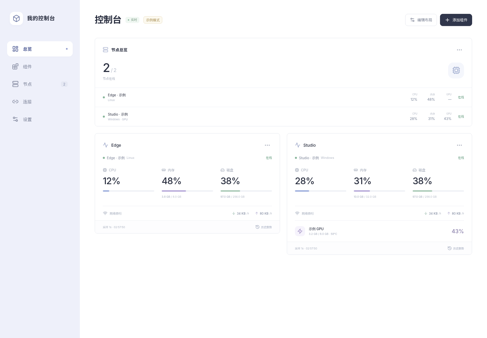

# Modular Console

一个可自行部署、按需组合组件的控制台框架。核心提供布局、主题、插件注册与访问控制；主机监控、NewAPI 用量等功能通过插件接入。

可以继续开发订阅额度查询等插件，组合成自己的控制台。



核心能力：

- 独立组件实例、排序、宽度与紧凑/详细布局。
- 标题、侧栏颜色、强调色、动画开关与刷新间隔配置。
- 插件注册与启停、管理员登录和本地配置持久化。

内置插件：

- **主机监控**：基础节点组件、GPU 节点组件与多节点汇总组件，支持历史趋势、节点令牌轮换。Linux / Windows 采集端主动上报；GPU 指标需要采集主机安装 `nvidia-smi`。
- **NewAPI 用量**：只读查询余额、累计消耗、累计请求与今日消耗；未提供的指标显示为不可用。

首次启动真实实例时总览为空。先添加数据源，再添加需要的组件；示例实例提供独立的合成数据。

## Docker Compose

需要 Docker Engine 与 Compose 插件。在仓库根目录执行：

```sh
docker compose up -d --build console
```

打开 <http://127.0.0.1:9470>。首次密码位于容器的 `/app/data/live/initial-password`，请仅在本机私密读取。登录后可在设置中修改密码。持久数据位于独立的 `console-data` 命名卷；容器内以非 root 的 `node` 用户运行。

只读示例使用单独的端口与数据卷：

```sh
docker compose --profile demo up -d --build demo
```

打开 <http://127.0.0.1:9471>，无需登录。示例不接受真实采集数据或配置修改，不要向示例卷写入真实凭据。

远程使用时先配置 HTTPS 反向代理和 `CONSOLE_PUBLIC_ORIGIN`，详见 [部署说明](docs/deployment.md)。Compose 默认仅绑定本机回环地址。

## 从源码运行

需要 Node.js **24.13.0+**（推荐 Node 24 LTS）和 npm。采集端另需 Python **3.10+**。

```sh
npm ci
npm run init
npm run build
npm start
```

默认监听 `127.0.0.1:9470`，私有运行目录为 `data/live`。首次密码保存在 `data/live/initial-password`，仅在本机私密读取。应用不会自动加载 `.env`；环境变量通过 shell、服务管理器或容器设置。

开发时运行 `npm run dev`，前端位于 `http://127.0.0.1:5173`，API 代理到 `9470`。独立示例可在构建后用 `npm run demo` 启动，默认 `9471`、`data/demo`；它不会读取真实实例的数据目录。

## 添加数据

1. 在「节点」中注册节点，保存只显示一次的令牌与配置文件。
2. 按 [采集端说明](agent/README.md) 安装 Python 依赖并运行采集端；Linux 和 Windows 的权限及自启动示例均在该文档中。
3. 在「组件」中选择基础节点、GPU 节点或汇总组件，选择数据源并保存。GPU 组件需要节点先报告 GPU 能力。
4. 如需 NewAPI，在「连接」中添加服务地址、用户 ID 与**用户访问令牌**，再添加额度组件。模型 API Key 不能替代用户访问令牌，详见 [NewAPI 说明](docs/newapi.md)。

采集间隔与界面推送间隔均可设置为 200–60000 毫秒，默认 1000 毫秒；实际速度受主机、网络与浏览器影响。NVIDIA 查询、磁盘枚举有各自较慢的采样周期。历史默认按 5 秒聚合、保留 30 天；离线与缺失测量保留为空值。NewAPI 独立每 30 秒刷新，手动刷新最少间隔 10 秒。

## 开发与扩展

```sh
npm run typecheck
npm test
python3 -m pip install -r agent/requirements.txt
python3 -m unittest discover -s agent/tests -v
npm run build
npm audit --omit=dev
```

浏览器测试：

```sh
npx playwright install chromium
npm run test:e2e
```

测试自动启动独立实例，验证登录、节点与组件操作、历史记录和移动布局。也可用 `PLAYWRIGHT_CHROMIUM_EXECUTABLE_PATH` 指定本机 Chromium。CI 执行类型检查、构建、Node/Python/浏览器测试、运行依赖审计及 Compose 配置检查。

插件是随应用编译、审核的可信代码，通过共享清单、前端渲染注册表和后端注册入口组合。主机采集、历史聚合与 NewAPI 连接分别放在对应插件内。新增插件需要修改代码并重新构建；首版没有运行时插件市场、热加载或第三方代码沙箱，具体接口见 [插件说明](docs/plugins.md)。

本项目提供单实例、单管理员工作流；尚无多租户、细粒度用户权限、分布式存储或告警调度。部署、备份与凭据管理方法见 [部署说明](docs/deployment.md)。

许可证：[MIT](LICENSE)。
